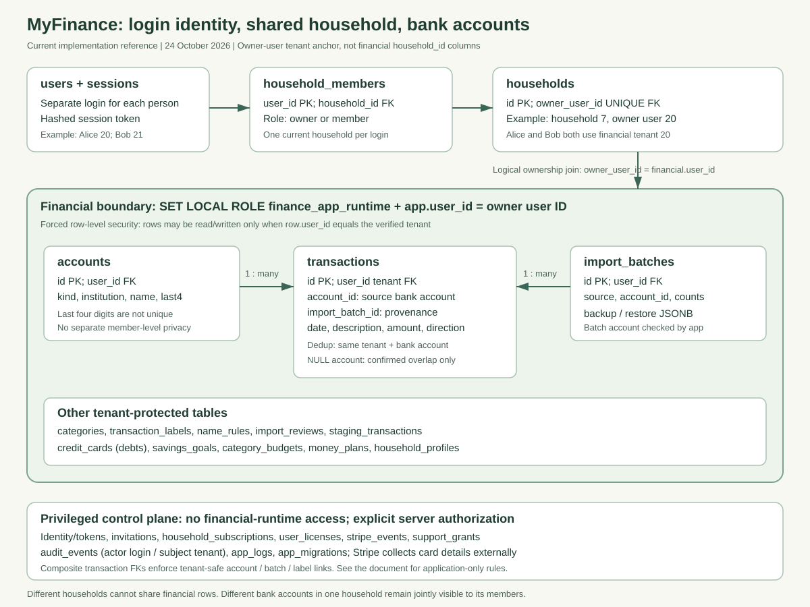
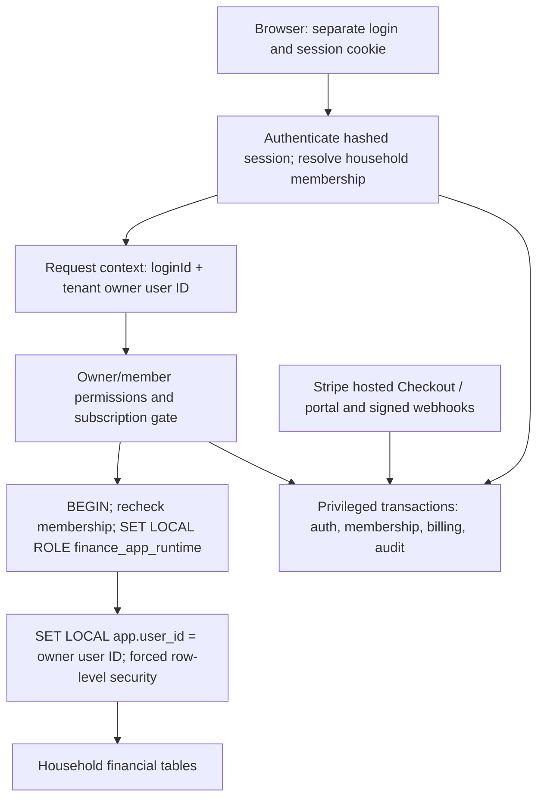
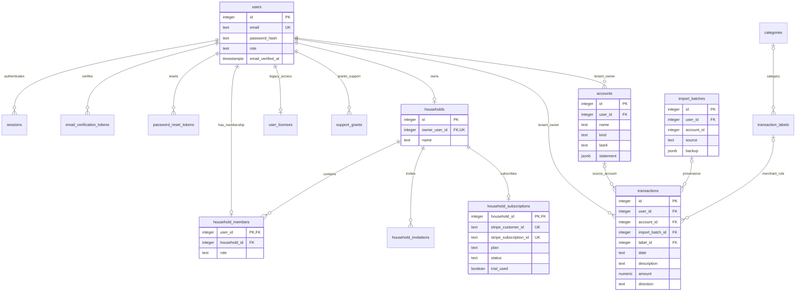

# Database architecture, account mapping, and import deduplication

Implementation reference: 24 October 2026. This describes the schema and code in
this repository, not an inspection of a deployed database or a security
certification. Startup migrations can preserve additional legacy columns.

## 1. Short answer: which transactions can be compared?

An incoming transaction is associated with **two different ownership keys**:

1. **Household tenant:** `transactions.user_id` is the original household owner's
   user ID. It is resolved from the authenticated login, not supplied by the file.
2. **Bank account:** `transactions.account_id` identifies the saved checking,
   savings, credit-card, or other account that supplied this transaction.

An exact import duplicate must belong to the **same household and same saved bank
account**, and match date, normalized description, amount, and direction.
An assigned transaction in a different bank account cannot suppress the new row.
An identical transaction in another household cannot be seen by the comparison.

**Legacy exception:** older transactions can have `account_id = NULL`. A matching
unassigned transaction in the same household may be shown in overlap review
because its account is unknown. The importer does not guess its account or
silently discard the incoming row. The user confirms the match or chooses to
import it as new. An unresolved exact unassigned overlap stops the import.

**Transfers are different:** reconciliation intentionally compares different bank
accounts within the same household to recognize both sides of a transfer.
Both records remain stored. This affects spending/income classification, not
duplicate deletion.

### Example

| Stored row | Incoming row | Outcome |
|---|---|---|
| Household A, checking 101, Oct 15, COFFEE, debit 10.00 | Same household/account and matching fields | Skip incoming exact duplicate |
| Household A, savings 102, otherwise identical | Household A, checking 101 | Keep both; different bank accounts |
| Household B, checking 201, otherwise identical | Household A, checking 101 | Keep both; different tenants |
| Household A, account NULL, otherwise identical | Household A, checking 101 | Require overlap confirmation; never guess |
| Household A, checking 101, same date/value, similar description | Same account, different description | Possible overlap review, not automatic fuzzy deletion |
| Household A, checking debit 100; savings credit 100 | Transfer between those accounts | Retain both; transfer reconciliation is separate |

The filename, account display name, and last four digits are **not the database
deduplication key**. Saved account IDs and the household tenant key are.

## 2. Architecture diagram

The following image is a standalone SVG suitable for inclusion in documentation:



Financial tables use an owner-user tenant anchor rather than a physical
`household_id` column. The household-to-financial-data relationship in the
diagram is a logical join through `households.owner_user_id = financial.user_id`.



### Relational diagram: identity, household, and financial data

This is an abbreviated ER diagram. See the constraint matrix for which
relationships are actual foreign keys. In particular, financial ownership
references `users.id`, not `households.id`.



Example: Alice is user 20, Bob is user 21, and both belong to household 7 owned
by Alice. Both use financial tenant 20, so their shared transaction rows have
`user_id = 20`. Bob's login remains 21 for sessions and audit actor identity.
A different household owned by user 30 sees tenant 30, never tenant 20.

Bank accounts within a household are **not access-control compartments**:
Alice and Bob can both see and edit all bank accounts in their household.

## 3. How files map to saved bank accounts

### CSV and OFX/QFX

1. The parser detects an account-number column or the supported OFX account
   identity. It normalizes the account identifier, hashes it to an `accountKey`,
   and extracts its last four digits when available.
2. Each parsed row carries this `accountKey`. Multiple account identities in one
   download become separate groups before saving transactions.
3. The server inspects saved accounts **only for the current household**.
   A unique saved account with matching last four digits and an accepted type
   can be mapped automatically.
4. A previously unseen, unambiguous account ending is created automatically,
   within the import transaction. CSV account-type columns and OFX type metadata
   supply recognized types; if absent, the new account is named from its ending
   and saved as `other`, not guessed as checking or savings. The result links to
   account details for renaming/type review. Missing identity, last-four
   collisions, conflicting types, external or unclassified saved accounts still require review.
   Explicit per-group `accountMappings` can select or create the appropriate
   saved account. A top-level account choice is a fallback for a single group
   or unidentified rows; it is not a blanket mapping for every identified
   account in a multi-account file.
5. The server validates every selected `accountId` against the tenant. A foreign
   account ID is rejected even if it exists in the database.
6. If an account ending was detected, it must match the selected account.
   Different detected account groups cannot be mapped to the same saved account.
   Ambiguous endings require explicit review rather than automatic reuse.
7. Recognized account types are fed back into parsing so deposit/card sign
   conventions match each resolved group. `other` retains the parser's
   bank-agnostic sign detection rather than forcing a deposit convention.
8. Rows are grouped by resolved saved account ID. The importer creates an import
   batch for each resolved account and saves each row with its `account_id` and
   `import_batch_id`. PostgreSQL supplies `user_id` from the transaction context.
   Inspection is read-only. Failed imports, missing mappings and overlap-review
   requests roll back automatic account creation as well as transaction writes.

The persisted `accounts` identity fields include name, institution, kind and
last four digits. The current schema does **not** have a unique full bank-account
identifier column. The hashed parser key distinguishes groups in an import;
it is not a durable foreign key or persisted unique bank-account identity.
Last-four collisions remain possible. Do not treat four digits as proof of
account ownership or global uniqueness.

### PDF statements

An explicit account/new-account choice is resolved within the tenant.
Otherwise, supported statement parsing uses account ending, institution, and
account kind to resolve or create a saved account. Ambiguous/conflicting
identities require account review. PDF statement metadata can be stored in
`accounts.statement`.

### Missing account information

When the file cannot identify its account, the user must select/create one.
New normal import flows do not deliberately create unassigned transaction
history. Nullable `transactions.account_id` supports older/unassigned/manual
data and migration/recovery scenarios.

## 4. Deduplication stages and safeguards

### A. Duplicates within a CSV file

The parser compares:

```text
(accountKey, date, description, amount, direction)
```

Different account groups in the same file do not deduplicate each other.
Identical repeated rows within the same CSV group are collapsed by the parser.
Consequently, two legitimate purchases with identical date, description,
amount and direction in the same account are not reliably distinguishable from
duplicate rows by CSV data alone. This is a limitation, not a transaction-ID
guarantee.

### B. Possible overlap with existing history

The importer fetches candidates only from the current tenant, with:

```text
same date + same cent amount + same direction
AND (existing account = incoming resolved account OR existing account IS NULL)
```

Normalized exact descriptions and merchant-word similarity determine review
candidates. Similarity uses merchant-core word overlap; it is not an AI decision
or automatic fuzzy merge. Different assigned bank accounts are excluded.
Existing exact matches already assigned to the incoming account proceed to the
normal exact duplicate check.

Review safeguards:

- Show the older transaction beside the incoming row and detected account.
- Only unambiguous, one-to-one exact candidates are bulk-confirm eligible.
- Require an acknowledged choice for every review row.
- An existing transaction cannot be retained for two incoming rows in a review.
- Hash and tenant-bind a single-use token, with a ten-minute expiry, to the file,
  account choices, and candidate snapshot.
- Recheck the snapshot at confirmation; changed/stale data requires review again.
- Confirming an unassigned match updates its account and transfer-review state,
  skips the incoming row, and preserves the existing ID, description, category,
  edits, and original import provenance.
- Choosing "new" explicitly bypasses the exact duplicate query for that reviewed
  incoming row. It can intentionally create an otherwise matching transaction.

### C. Exact duplicate check before insertion

The implementation is equivalent to this predicate (illustrative SQL):

```sql
WHERE user_id = current_setting('app.user_id')::integer
  AND date::date = :incoming_date::date
  AND UPPER(BTRIM(regexp_replace(description, '[[:space:]]+', ' ', 'g')))
      = :normalized_incoming_description
  AND ROUND(amount::numeric, 2) = :incoming_amount
  AND UPPER(BTRIM(direction)) = :incoming_direction
  AND (
    account_id IS NOT DISTINCT FROM :resolved_account_id
    OR (:resolved_account_id IS NOT NULL AND account_id IS NULL)
  )
```

The NULL-account branch is a **guard**, not automatic deduplication:
if the selected stored row is unassigned and the incoming row has an account,
the importer raises `UNASSIGNED_OVERLAP` rather than skipping/inserting by guess.
The normal CSV overlap flow is intended to obtain confirmation first.

PDF statement imports additionally track matching-row occurrence counts so
multiple identical statement entries can be retained/reimported by occurrence.
This is not a database uniqueness constraint or universal bank transaction-ID
matching.

### D. Atomicity and concurrency

Imports and recovery acquire a transaction-scoped advisory lock keyed by
household owner user ID. Two import requests for the same household serialize
before reading/writing their transaction history. Different households use
different lock keys. Account resolution, overlap decisions, inserts, import
provenance, and reconciliation run in a database transaction; a failure rolls
back the operation rather than leaving a partial import.

There is **no unique transaction constraint** on date/description/amount/account.
Duplicate prevention is import application logic plus locking. Direct SQL,
other write paths, explicit "new" decisions, or pre-existing duplicate data are
not magically corrected by a unique index.

### E. Reconciliation and rules are not deduplication

Transfer pairing compares different accounts only within the household. Merchant
category/name rules and inherited payment/income settings can also be shared
across that household's bank accounts. These do not authorize cross-household
reads, and do not suppress rows as duplicates.

## 5. Complete application-table inventory

All 13 financial/private tables below receive the following through migration:

- `user_id INTEGER NOT NULL REFERENCES users(id)`;
- default `user_id` from transaction-local `app.user_id`;
- unique `(id, user_id)` index and nonunique `(user_id)` index;
- enabled and forced RLS with tenant-matching read/write policies;
- SELECT/INSERT/UPDATE/DELETE granted to `finance_app_runtime`.

Primary keys are integer `SERIAL id` unless otherwise noted. This dictionary
lists the application-defined columns by group; startup may retain older columns.

### Financial tables: protected by tenant RLS

| Table | Columns beyond `id` and `user_id` | Purpose / special rules |
|---|---|---|
| `accounts` | `name`, `kind`, `institution`, `last4`, `status`, `suggested_kind`, `discovered_from`, `statement`, `created_at`, `updated_at` | Saved bank-account identity and statement JSONB; `last4` is not unique |
| `transactions` | `date`, `description`, `amount`, `direction`, `balance`, `source`, `created_at`, `category`, `label_id`, `is_fixed`, `category_corrected`, `previous_category`, `correction_timestamp`, `pay_mode`, `income_role`, `account_id`, `transfer_kind`, `transfer_account_id`, `transfer_pair_id`, `transfer_checked`, `display_name`, `name_override`, `import_batch_id` | Imported/manual ledger; source account, provenance, corrections, transfer and display metadata |
| `categories` | `name`, `icon`, `color` | Unique `(user_id, name)` |
| `transaction_labels` | `pattern`, `display_label`, `category_id`, `is_fixed`, `is_excluded`, `created_at`, `match_type`, `enabled`, `priority` | Merchant/category rules; unique `(user_id, pattern)` |
| `name_rules` | `pattern`, `name`, `created_at` | Display-name rules; unique `(user_id, pattern)` |
| `import_batches` | `source`, `account_id`, `created_at`, `status`, `legacy`, `imported`, `duplicates`, `statement_before`, `statement_after`, `statement_changed`, `backup`, `restore_guard`, `undone_at` | Per-import/account provenance and recovery JSONB snapshots |
| `import_reviews` | `token_hash`, `payload`, `expires_at` | Unique token hash, JSONB overlap/recovery review payload; five-minute schema default, ten minutes explicitly for overlap |
| `staging_transactions` | `date`, `description`, `amount`, `direction`, `balance`, `source`, `status`, `error_message`, `created_at` | Legacy import queue; not the primary current CSV flow |
| `credit_cards` | `name`, `balance`, `apr`, `credit_limit`, `min_payment`, `due_date`, `debt_type`, `payment_in_history`, `included`, `focus`, `custom_rank` | Debt-planning records, including non-card debts; not a declared FK extension of `accounts` |
| `savings_goals` | `name`, `target_amount`, `current_amount`, `target_date`, `priority`, `icon`, `color`, `notes`, `created_at`, `included`, `monthly_contribution`, `contribution_day` | Goals and planning inputs |
| `category_budgets` | `category`, `monthly_amount`, `updated_at` | Positive monthly amount; unique `(user_id, category)` |
| `money_plans` | `debt_strategy`, `debt_budget`, `goal_strategy`, `goal_budget`, `flex`, `updated_at` | Unique `user_id`; monthly flexibility JSONB |
| `household_profiles` | `household_size`, `region`, `housing`, `updated_at` | Unique `user_id`; spending benchmark inputs, not membership |

Money amounts principally use `NUMERIC(14,2)`; debt APR uses `NUMERIC(7,3)`.
Transaction/staging dates and goal target dates are currently TEXT, not SQL DATE.
Startup normalizes readable stored transaction dates to ISO and clears unreadable
legacy date values. This does not make TEXT columns inherently date-constrained.

### Identity, control-plane, and operational tables: privileged access

These 15 tables are not granted to the financial runtime role. They are accessed
through administrative transactions with explicit application authorization.
They do not inherit the financial-table RLS policy.

| Table | Key and columns | Constraints / responsibility |
|---|---|---|
| `users` | PK `id`; `name`, `email`, `role`, `password_hash`, `created_at`, `password_changed_at`, `email_verified_at` | Unique email and unique `lower(email)` index; separate login identity |
| `sessions` | PK `token_hash`; `user_id`, `expires_at`, `created_at`, `last_activity_at`, `actor_user_id`, `support_grant_id` | User/support FKs; hashed tokens, idle/absolute expiry |
| `auth_attempts` | PK `key`; `attempts`, `reset_at` | Hashed IP/email/invitation throttling keys |
| `password_reset_tokens` | PK `token_hash`; `user_id`, `expires_at`, `used_at`, `created_at` | User FK with cascade delete |
| `email_verification_tokens` | PK `token_hash`; `user_id`, `expires_at`, `created_at` | User FK with cascade delete; consumed tokens deleted |
| `households` | PK `id`; `owner_user_id`, `name`, `created_at` | Unique nonnull owner FK to users |
| `household_members` | PK `user_id`; `household_id`, `role`, `created_at` | User/household FKs with cascade delete; one membership per login; role `owner` or `member` |
| `household_invitations` | PK `id`; `household_id`, `email`, `token_hash`, `invited_by`, `expires_at`, `used_at`, `created_at` | Unique token hash; household, inviter FKs; email binding checked in application |
| `household_subscriptions` | PK/FK `household_id`; `stripe_customer_id`, `stripe_subscription_id`, `plan`, `status`, `trial_started_at`, `trial_ends_at`, `current_period_end`, `cancel_at_period_end`, `trial_used`, `checkout_session_id`, `checkout_expires_at`, `reminder_sent_at`, `updated_at` | One local row per household; unique Stripe customer/subscription IDs; plan `basic` or `pro` |
| `user_licenses` | PK/FK `user_id`; `plan`, `trial_started_at`, `trial_ends_at`, `granted_at`, `granted_by`, `revoked_at`, `updated_at`, `requested_plan`, `requested_at` | Preserved manual/legacy access; old request columns retained, not current checkout workflow |
| `stripe_events` | PK `id`; `event_type`, `processed_at` | Processed Stripe event IDs for idempotency; not an event-payload/card archive |
| `support_grants` | PK `id`; `user_id`, `access_level`, `reason`, `created_at`, `expires_at`, `revoked_at`, `last_used_at` | Household-owner tenant user FK; read/write level check; time-limited consent |
| `audit_events` | BIGSERIAL PK `id`; `created_at`, `event_type`, `outcome`, `actor_user_id`, `subject_user_id`, `support_grant_id`, `request_id`, `ip_hash`, `email_hash`, `method`, `path`, `status`, `detail` | Actor/subject IDs are historical values, not declared FKs; UPDATE trigger rejects edits, but retention DELETE remains possible |
| `app_logs` | BIGSERIAL PK `id`; `entry_id`, `created_at`, `level`, `source`, `message`, `request_id`, `route`, `status`, `instance` | Unique `entry_id`; operational warning/error records |
| `app_migrations` | PK `id`; `applied_at` | One-time migration markers |

## 6. Constraint matrix: database enforcement versus application rules

| Protection | Where enforced | Exact scope / limitation |
|---|---|---|
| Financial reads stay in tenant | Forced RLS `private_user` | Runtime role sees rows matching transaction-local tenant |
| Financial inserts/updates stay in tenant | RLS `WITH CHECK`, nonnull user FK | Cannot write a row for a different tenant through runtime role |
| Transaction source account belongs to same tenant | `transactions_tenant_account_fk` | `(account_id, user_id)` references `accounts(id, user_id)` |
| Transaction import batch belongs to same tenant | `transactions_tenant_import_fk` | `(import_batch_id, user_id)` references `import_batches(id, user_id)` |
| Transaction label belongs to same tenant | `transactions_tenant_label_fk` | `(label_id, user_id)` references `transaction_labels(id, user_id)` |
| Rule category belongs to same tenant | `labels_tenant_category_fk` | `(category_id, user_id)` references `categories(id, user_id)` |
| One current membership per login | `household_members.user_id` PK | No simultaneous membership in multiple households |
| Owner membership consistency | Partial unique index and `household_member_owner` trigger | At most one owner membership per household; owner role must match owner user ID on member INSERT/UPDATE |
| Every household always has an owner membership | Application initialization/join/remove rules | Not a deferred DB assertion; deleting membership or changing household owner directly is not covered by the membership trigger alone |
| Up to ten members/pending invites | Application checks under household row lock | Not a table CHECK constraint |
| No foreign saved account selected for import | Tenant-filtered account resolver plus composite FK | Invalid/foreign account request rejected before insert |
| Batch `account_id` belongs to tenant | Application import/recovery logic | No declared FK for `import_batches.account_id` |
| Transfer partner references | Tenant-filtered reconciliation/application logic | `transfer_account_id` / `transfer_pair_id` have no declared composite FKs |
| Transaction account equals its batch's account | Application import logic | Separate tenant FKs do not enforce account equality between transaction and batch |
| Category text remains valid | Application validation/classification | `transactions.category` and budget category are text, not category FKs |
| No duplicate imported transaction | Parser/import logic plus tenant advisory lock | Not a database unique constraint |
| One live Stripe subscription | Checkout locking, Stripe state, webhook checks | Unique local Stripe ID alone cannot prevent externally created extra subscriptions |
| Trial cannot restart for returning household | Persisted `trial_used` and legacy-trial checks | Not person-level detection of unrelated email accounts |
| Owner alone manages billing/members | Server route permission checks | Financial RLS does not substitute for privileged route checks |

RLS protects the restricted financial role, not a malicious database
superuser/authorized infrastructure operator. Financial and privileged paths
share a pool whose connection identity has administrative privileges; the
application explicitly switches role inside each financial transaction.
This is not a physically separate database or separate login pool.

## 7. Indexes, performance, and transaction lifetime

Relevant additional indexes:

| Index | Columns / purpose |
|---|---|
| `transactions_user_date_idx` | `(user_id, date)` |
| `transactions_user_account_idx` | `(user_id, account_id)` |
| `transactions_import_batch_idx` | `(user_id, import_batch_id)` |
| `transactions_import_review_idx` | `(user_id, import_batch_id, date DESC, id DESC)` |
| `import_batches_review_idx` | `(user_id, id DESC)` |
| `household_members_household_idx` | Membership lookup by household |
| `household_one_owner_idx` | Unique household where member role is owner |
| `household_invites_household_idx` | Invitations by household |
| `sessions_expiry_idx` | Session expiry |
| `audit_events_*` | Creation/type/subject/request correlation |
| `app_logs_*` | Creation/request correlation |

Exact duplicate queries cast dates and normalize descriptions/amounts at query
time. Existing tenant/account indexes narrow access, but there is no persisted
dedup fingerprint or expression index for the entire exact predicate. Do not
interpret these indexes as proof that import cost is constant at any history size.

Overlap candidate retrieval is file-value filtered, with a 2,001-row sentinel
and rejection above 2,000 candidates; review is capped at 500 incoming rows and
2,000 candidate links. Diagnostic transaction pages cap responses at 100 rows;
import-list pages use a 30-batch cursor. Other screens, including the current
all-transactions endpoint and account-summary aggregation, can still load all
transactions for a household. Recovery review snapshots also inspect household
history. Those paths may need further profiling/pagination for much larger datasets.

Financial transactions recheck login membership before switching role.
Transaction-local settings prevent tenant context surviving commit/rollback
into the next pooled request. Writable financial operations hold a shared
membership row lock so removal cannot overtake an authorized edit. Read-only
support transactions use database read-only mode. An authorized read already
in flight may complete during removal.

## 8. Billing and lifecycle relationship

One household subscription covers every member, independently of how many bank
accounts it contains. Bank statement records are not sent to Stripe for billing.
Card details are collected by Stripe, not stored in these tables.

Signed webhook processing retrieves authoritative Stripe state and records event
IDs. It updates the household subscription; the subscription gate then applies
to every member. Canceling does not delete bank accounts or transaction data.
Returning under the same household preserves records and must pay after a used
trial. Canceling an old subscription must not let a late webhook overwrite its
paid replacement.

See [privacy and operational boundaries](./ACCOUNT_DATA_PRIVACY.md) and
[deployment requirements](./DEPLOYMENT.md).

## 9. Evidence and repeatable checks

The isolated multi-household regression exercised:

- 24 households, 32 customer logins, 48 bank accounts, 24,000 transactions;
- identical CSVs across tenants and account types;
- 12,000 repeated rows skipped only in the correct account;
- logout/login for every customer and a 32-login concurrent read burst;
- 1,200 foreign-ID access/edit probes with expected rejections;
- Basic/Pro entitlement changes, cancellations, reminders, payment failures,
  signed/duplicate/stale webhooks and paid resubscription without a repeat trial.

No cross-household exposure or unauthorized edits were detected in those tested
paths. PGlite serializes test database connections; Stripe/SMTP were fakes.
This is neither a production capacity benchmark nor a complete security audit.

```powershell
node --test backend\utils\household-scale.test.js backend\utils\household-billing.test.js
```

Implementation sources:

- [Schema, constraints, policies, migrations](./backend/utils/schema.js)
- [Financial/administrative transactions](./backend/db.js)
- [Request tenant context](./backend/utils/tenant.js)
- [Household membership](./backend/utils/households.js)
- [Account mapping](./backend/routes/accounts.js)
- [File account groups and parser dedup](./backend/utils/transaction-parser.js)
- [Import exact comparison and insertion](./backend/routes/import.js)
- [Overlap confirmation](./backend/utils/importOverlap.js)
- [Import locking, history, recovery](./backend/utils/importHistory.js)
- [Transfer reconciliation](./backend/utils/transfers.js)
- [Billing synchronization](./backend/utils/billing.js)
- [Multi-household regression](./backend/utils/household-scale.test.js)
